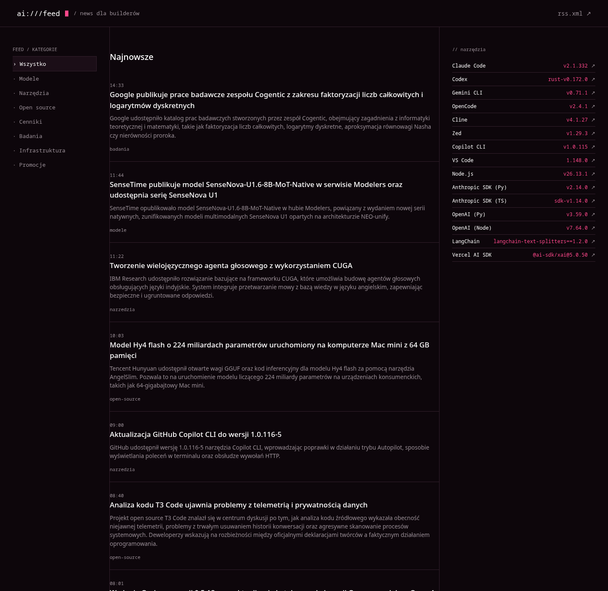

# ai:///feed

### Wiadomości o AI po polsku. Bez clickbaitu, bez reklam, bez szumu.

Zagląda do kilkudziesięciu źródeł z całego świata, wybiera to, co naprawdę
przydaje się osobom, które budują z AI, i tłumaczy na polski.

**[→ ai.gradzik.org](https://ai.gradzik.org)**

---

## Co to jest

Codzienny przegląd świata AI, pisany z myślą o programistach: nowe modele i API,
narzędzia i agenty, open source, benchmarki, ceny oraz infrastruktura. Zamiast
przewijać kilkadziesiąt kanałów i czytać maszynowe tłumaczenia, wchodzisz w jedno
miejsce i widzisz, co się faktycznie zmieniło.

Wszystko jest po polsku, z odnośnikiem do źródła, żeby każdy fakt dało się sprawdzić.

## Jak to działa

1. **Zbiera** wpisy z kilkudziesięciu źródeł: blogów i changelogów dostawców modeli,
   wydań narzędzi na GitHubie, niezależnych analityków oraz chińskich serwisów
   technologicznych.
2. **Odsiewa** politykę, biznes, sprzedaż i reklamy. Zostaje to, co dotyczy
   narzędzi, modeli i pracy programisty.
3. **Łączy w wątki.** Piętnaście commitów z jednego repozytorium to nie piętnaście
   newsów, tylko jedna historia o tym, co się w nim zmieniło. Każdy wątek dostaje
   tytuł z zakresem zmian („od wersji 6.2.0 do 7.0.2").
4. **Tłumaczy i redaguje** na polski: rzeczowo, bez metafor i bez dopisywania
   faktów, których nie ma w źródle.
5. **Publikuje** na bieżąco. Nowe materiały trafiają na stronę tego samego dnia,
   a strona odświeża się co godzinę.

## Co znajdziesz na stronie

| | |
|---|---|
| **Feed** | Najnowsze wiadomości, pogrupowane w wątki |
| **Kategorie** | Modele, narzędzia, open source, cenniki, badania, infrastruktura |
| **Promocje** | Oferty i zmiany cen u dostawców, oddzielone od newsów, bo mają terminy ważności |
| **Panel narzędzi** | Najnowsze wersje popularnych narzędzi i SDK, prosto z ich wydań na GitHubie |
| **RSS** | [ai.gradzik.org/rss.xml](https://ai.gradzik.org/rss.xml), jeśli wolisz czytnik |

## Zasady, których się trzymamy

- **Każdy artykuł ma źródło.** Zawsze jest link do materiału, na którym się opiera.
- **Tłumaczenie, nie streszczenie.** Obszerna publikacja daje obszerny artykuł.
- **Żadnych dopowiedzeń.** Jeżeli w źródle nie ma ceny albo wyniku benchmarku,
  w artykule też go nie będzie.
- **Jawna informacja o AI.** Pod każdym artykułem widać, że treść jest tłumaczeniem
  maszynowym i który model je przygotował.

## Dla osób technicznych

Cały serwis powstaje automatycznie: pobieranie źródeł, klasyfikacja, łączenie
tematów, redakcja i publikacja jako statyczna strona. Kod jest otwarty, więc
możesz zobaczyć, jak to działa, albo postawić własną wersję.

- **Stos:** Python 3.12+, SQLite, Jinja2, statyczny HTML
- **Uruchomienie:** `PYTHONPATH=. python -m aifeed`, konfiguracja przez `.env`
  (wzór w [`.env.example`](.env.example))
- **Modele:** dowolne API zgodne z OpenAI, w tym lokalne

Instrukcja developerska i opis architektury są w kodzie i w `docs/`.

## Licencja

[GNU Lesser General Public License v3.0](LICENSE), wyłącznie wersja 3.0.
Zobacz też [COPYING](COPYING).

---

**[ai.gradzik.org](https://ai.gradzik.org)** · aktualizowane co godzinę · bez reklam i bez śledzenia

